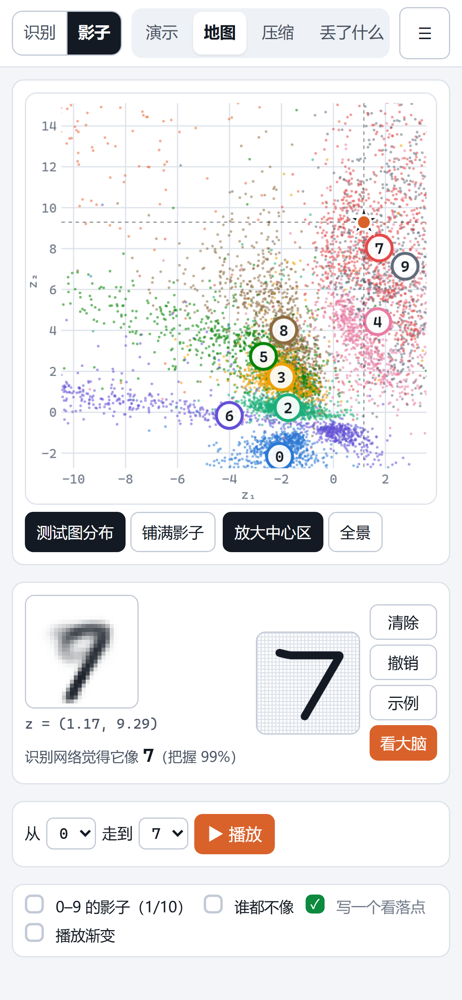

> **AI 教学演示案例 / AI Teaching Demos** 系列

# 手写数字实验台

两课连着学：**第一课 · 识别**，手写一个数字，看卷积神经网络怎样一层层认出它；**第二课 · 影子**，把同样的卷积网络反过来用，把数字压成平面上的一个点，再从地图上任意一点画回一个数字的"影子"。

**Shuyao Gao**（gaoshuyao.mk@gmail.com）· aSSIST University (Seoul School of Integrated Sciences and Technologies) · 서울과학종합대학원대학교
代码 MIT，文档与教学素材 CC BY 4.0，使用请注明出处；内嵌的 MNIST 数据按 CC BY-SA 3.0 再分发（见 [THIRD_PARTY.md](THIRD_PARTY.md)）。

打开网页就是一个手写板和一块"网络内部"面板。面板最上面是**网络结构图**：每一层画成一叠真实的特征图，块的大小对应特征图的边长，叠的厚度对应通道数，下面写着层的类型、形状、神经元数和参数量。
鼠标停在某一层上，会说明它有几个卷积核、每个神经元连着上一层哪些位置、参数怎么算；点一下，播放这一层怎么算：卷积核在图上滑动、2×2 最大池化、全连接神经元求和、反卷积"盖章"放大，用的都是真实权重和你刚写的数字。
第二课的结构图是一个沙漏：编码器一路压缩到 2 个数，解码器再一路放大回 28×28。适合机器学习、深度学习入门课做课堂演示。

**English summary.** *Handwritten Digit Lab* is a browser-based teaching demo in two lessons, built on MNIST. In Lesson 1 you draw a digit and watch three networks (fully connected only, a small CNN, a standard CNN) recognise it in real time. A live architecture diagram draws every layer as a stack of its real feature maps, with neuron and parameter counts and connection rules. Clicking a layer plays an animation of how it computes, using the real weights. Lesson 2 trains the same convolutional encoder as an autoencoder: every digit becomes a point on a 2-D map, and the decoder draws a "shadow" digit from any point you drag to. It also compares bottleneck sizes and shows how much of the input survives in each layer of the recognition network. Everything runs in pure JavaScript, offline from `file://`. UI and documentation are in Chinese.


| 手机：写字 | 手机：看大脑（结构图可左右滑） | 手机：第二课地图 |
|---|---|---|
|  |  |  |

## 怎么打开：不用安装任何东西

- **手机**：点在线链接 <https://shuyaogao.github.io/handwritten-digit-lab/>（iPhone、安卓的浏览器都可以，竖屏使用）。
- **电脑**（Windows、macOS）三种方式任选：
  1. 点上面的在线链接；
  2. 在本仓库右侧 **Releases** 里下载 `handwritten-digit-lab-v1.0.zip`（约 6.4 MB），解压后双击文件夹里的 `index.html`（或 `双击打开.html`）；
  3. 点 **Code → Download ZIP**，解压后双击 **`play/index.html`**。

不需要 Python，不需要联网：网络权重、示例图片都在 `play/assets/` 里，推理用纯 JavaScript 在浏览器里完成。第二课的模型（约 8 MB）在第一次进入第二课时才加载。

## 怎么用

顶部左边切换课程（第一课 · 识别 / 第二课 · 影子），右边切换这一课的模式。

| 课程 | 模式 | 内容 |
|---|---|---|
| 第一课 · 识别 | 演示（打开即是） | 自动轮播测试集里的手写数字，右边实时显示网络内部 |
| | 我来写 | 自由书写；"示例"从测试集随机取一张；三档网络（只有全连接 / 小卷积 / 标准卷积）可换 |
| | 练习 | 4 个小任务，完成自动打勾：让 0–9 都被认对；写一个让网络犹豫的数字；敲掉神经元让它改判；找一个三档网络判断不一样的数字 |
| 第二课 · 影子 | 演示 | 橙色的点在 2 维地图上自动游走，影子实时变化 |
| | 数字地图 | 自己拖、自己写；练习任务：找到 0–9 每个数字的影子、找一个谁都不像的影子、写一个数字看落点、播放一次渐变 |
| | 压缩多少 | 同一张图压成 2/4/10/16/32 个数再还原；"拧旋钮"直接改编码里的数 |
| | 识别网络丢了什么 | 第一课的识别网络冻结，每一层（C1、C2、F1、输出层）各配一个反演解码器，看还能还原出多少；与自编码器对照 |

**电脑（键盘鼠标）**：在画板上按住左键写字；第二课鼠标在地图上移动即可看影子。点特征图小方块或圆点把它敲掉，"全部恢复"复原。
快捷键：第一课 <kbd>C</kbd> 清除、<kbd>Z</kbd> 撤销、<kbd>E</kbd> 示例、<kbd>1</kbd>/<kbd>2</kbd>/<kbd>3</kbd> 换网络、<kbd>空格</kbd> 暂停演示；第二课 <kbd>G</kbd> 铺满影子、<kbd>F</kbd> 全景 / 放大、<kbd>P</kbd> 播放渐变；通用 <kbd>H</kbd> 操作说明、<kbd>Esc</kbd> 关闭。
右上角"大屏模式"把右栏加宽，适合投影；"退出"停止运行。

**手机（触屏）**：竖屏使用。第一课上方是"模型看到的 28×28"和判断，下方是画板；第二课上方是地图，下方是影子和小画板。
点"看大脑"全屏看网络结构和每一层（结构图可以左右滑，点某一层看它怎么算），"返回"回来。右上角 ☰ 里有本课的选项、操作说明、退出。

已测试（Windows）：Chrome 完整验收，电脑 1920×1080 与 1366×768，手机用 DevTools 模拟 390×844、414×896、360×780 与平板 768×1024（开启触屏）；Edge 做了冒烟测试（无头 Edge 会把页面当后台页降帧，长时间的自动化验收不可靠）。184 项检查通过 184 项（`python -m webapp.browser_check`）。Safari、真实手机和前台的 Edge 窗口未自动测试，请在真机上确认。

## 网络结构图怎么读

| 画法 | 含义 |
|---|---|
| 一叠方块 | 卷积层 / 池化层 / 反卷积层的输出：边长 ∝ 特征图边长，叠的厚度 ∝ 通道数（最多画 6 张，右上角写着总数），方块上是此刻激活最强的几个通道 |
| 一根竖条 | 全连接层或编码层：每一格是一个神经元（太多时按区段取平均），颜色越深越活跃；编码层可正可负，橙正蓝负 |
| 块下面的文字 | 层的类型、形状（通道@高×宽）、神经元个数、参数个数 |
| 悬停 | 画出这一层一个神经元在上一层看哪里（卷积是一个 3×3 小窗，全连接是上一层全部），下方写明连接方式和参数公式 |
| 点击 | 播放这一层怎么算：卷积核滑动、2×2 最大池化、全连接求和、反卷积盖章；"单步"一步一步看，"换一个通道"看别的卷积核 |

结构图里每一层的形状、神经元数和参数量都是网页从实际权重推出来的，测试保证各层参数之和与训练端完全一致（`tests/test_archviz.py`）。

## 课堂上怎么用（10 分钟）

**第一课 · 识别（5 分钟）**

1. **演示**：先不讲原理，让大家看网络自动认测试集的数字，注意右边结构图上每一层的变化。
2. **请一位同学上来写**：看"模型实际看到的 28×28"。笔迹先被裁剪、缩放进 20×20、按质心居中，这就是预处理。
3. **点结构图里的第一个卷积层**：一个 3×3 卷积核在图上滑动，每到一处乘加一次，得到右边特征图上的一个点。16 个卷积核就有 16 张特征图。
4. **换网络**：只有全连接的网络有 101,770 个参数，小卷积网络只有 13,242 个，两者的测试准确率却几乎一样（98.05% 对 98.06%）。为什么卷积能省这么多参数？
5. **敲神经元**：随机敲掉 25%，网络还认得出吗？敲掉哪几个会让它改判？

**第二课 · 影子（5 分钟）**

1. **看结构图**：沙漏形。左半边就是第一课的卷积网络，只是最后不输出"是几"，而是输出 2 个数；右半边用反卷积把 2 个数一路画回 28×28。
2. **演示 / 地图**：地图上每个点是一张图被压成的 2 个数。0、1、6 各自成团；4 与 9、3/5/8 挤在一起。拖到空白处，解码器照样画出一个影子。
3. **压缩多少**：2 个数的平均像素误差是 0.0383，32 个数降到 0.0051。拧旋钮，看每个数大致管着什么。
4. **识别网络丢了什么**：第一课的网络越往深层，还原得越模糊；输出层只有 10 个数，还原出来的同一个数字几乎长一个样（误差 0.0283），但仍有 96.8% 被认对。
   同样 10 个数的自编码器误差只有 0.0122。识别网络只记得"是几"，自编码器记得"长什么样"。

## 它是怎么做的

**第一课**（数字来自 `results/digit_lab/run_2026-10-14_215943/result.json`，MNIST 训练集 60,000 张训练、测试集 10,000 张评估）

| 网络 | 结构 | 参数 | 测试准确率 |
|---|---|---|---|
| 只有全连接 | 输入 784（28×28） → 全连接 128 → 输出 10 类 | 101,770 | 98.05% |
| 小卷积网络 | 输入 784（28×28） → 卷积 4@28×28 → 池化 4@14×14 → 卷积 8@14×14 → 池化 8@7×7 → 全连接 32 → 输出 10 类 | 13,242 | 98.06% |
| 标准卷积网络 | 输入 784（28×28） → 卷积 16@28×28 → 池化 16@14×14 → 卷积 32@14×14 → 池化 32@7×7 → 全连接 128 → 输出 10 类 | 206,922 | 99.44% |

每档训练 15 轮（Adam + OneCycle）；每批随机旋转 ±12°、缩放 0.85–1.10、平移 ±2 像素；测试集不增强。三档合计 18 秒（RTX 5090 Laptop GPU）。
"网络在看哪里"用遮挡法：依次把 5×5 的小块置零，看预测类别的对数概率下降多少。

**第二课**（数字来自 `results/digit_map/run_2026-10-14_113317/result.json`，测试集 10,000 张）

识别网络与自编码器的编码器用完全相同的卷积结构（3×3 卷积 → ReLU → 2×2 最大池化，两次），只是训练目标不同。

| 还原来源 | 数字个数 | 像素误差 MSE | 还原图被识别网络认对 |
|---|---|---|---|
| 识别网络 C1 | 3136 | 0.0012 | 99.0% |
| 识别网络 C2 | 1568 | 0.0030 | 98.8% |
| 识别网络 F1 | 128 | 0.0100 | 97.7% |
| 识别网络 输出层 | 10 | 0.0283 | 96.8% |
| 自编码器 32 维 | 32 | 0.0051 | 98.4% |
| 自编码器 16 维 | 16 | 0.0078 | 97.5% |
| 自编码器 10 维 | 10 | 0.0122 | 95.8% |
| 自编码器 4 维 | 4 | 0.0261 | 92.0% |
| 自编码器 2 维 | 2 | 0.0383 | 75.2% |

这里的识别网络测试准确率 99.16%；2 维编码只用 5 个最近邻认数字，准确率 72.6%（随机猜 10%）。全部 10 个网络训练合计 87 秒（RTX 5090 Laptop GPU）。

- 各层的反演解码器大小不同（C1、C2 用小型卷积解码器），层间比较是"同等训练下能还原多少"，不是严格的信息量上界。
- 2 维自编码器没有加正则化，编码的尺度很不均匀（"1" 分布得很远），所以地图默认放大中心区，可以切到全景。

**网页端**：权重以 float16 内嵌在 `play/assets/gen/`；`common/nn.js` 用纯 JavaScript 做前向计算，测试保证它与 PyTorch 的输出一致（`tests/test_digit_lab_parity.py`、`tests/test_digit_map_parity.py`）。

## 想自己训练或修改

```bash
pip install -r requirements.txt     # PyTorch 请按自己的显卡装对应的 CUDA 版本（RTX 50 系需要 CUDA 12.8 以上）
python -m digit_lab.train           # 第一课：三档识别网络；首次运行会自动下载 MNIST；RTX 5090 Laptop 上约 18 秒
python -m digit_map.train           # 第二课：识别网络 + 反演解码器 + 5 个自编码器，结束时自动导出；约 87 秒
python -m webapp.build --release    # 生成 play/ 和 release/handwritten-digit-lab-v1.0.zip
python -m pytest                    # 网页端推理与 PyTorch 一致、结构图数字正确、构建产物合规、隐私扫描
python -m webapp.browser_check      # 浏览器验收（需要本机装有 Chrome 或 Edge）
```

CPU 也能训练，只是慢很多。署名、版本号集中在 `credits.json`，改完运行 `python tools/fill_credits.py` 重建网页。

## 目录结构

```
play/                  网页本体（双击 index.html 即可使用）
  assets/gen/          lab.js（第一课的三档网络）、core.js / compress.js / invert.js（第二课，按需加载）
webapp/                网页源码（web/：index.html、lab.js 第一课、map.js 第二课、app.css）、构建、浏览器验收
digit_lab/             第一课的训练脚本
digit_map/             第二课的训练与导出脚本
common/                公共部分：nn.js（纯 JS 推理）、arch.js（结构式）、archviz.js（网络结构图与动画）、pad.js（手写板与预处理）、ui.js、base.css
results/               两课的训练结果：result.json（全部指标）、_env_stamp.json（运行环境）、raw/（原始输出）、export/（网页用的数据）
tests/                 测试
docs/media/            截图
```

## 常见问题

- **关掉标签页就全部结束了吗？** 是。网页不启动任何后台进程，也不联网；关掉标签页即结束。"退出"按钮会停止运行并提示可以关闭。
- **写的数字认错了？** 试试写大一点、写在方格中央。网络只在 MNIST 上训练过，MNIST 收集的是美国人口普查局职员和高中生的手写体，书写习惯和我们不完全一样（比如 7 大多不带中间那一横）。
- **第二课的影子为什么有的很模糊？** 那里没有训练数据，解码器只能"猜"。普通自编码器不保证编码空间处处有意义，这正是后来变分自编码器（VAE）要解决的问题。
- **手机上第一次进第二课有点慢？** 第一次要加载第二课的模型（约 2 MB，"压缩多少"再加载约 4 MB），之后就快了。
- **为什么不用 TensorFlow.js？** 为了双击 `index.html` 也能用：浏览器在 `file://` 下不允许读取外部权重文件，所以权重内嵌在 `.js` 里，推理自己写。

## 许可证与引用

代码 MIT（[LICENSE](LICENSE)），文档与教学素材 CC BY 4.0（[LICENSE-docs](LICENSE-docs)），使用请注明出处。
内嵌的 MNIST 图片及其派生数据（还原图、2 维编码坐标）按 CC BY-SA 3.0 再分发，详见 [THIRD_PARTY.md](THIRD_PARTY.md)。引用格式见 [CITATION.cff](CITATION.cff)。

## AI 辅助开发声明

代码由 Claude Code 辅助编写，经作者审阅。
